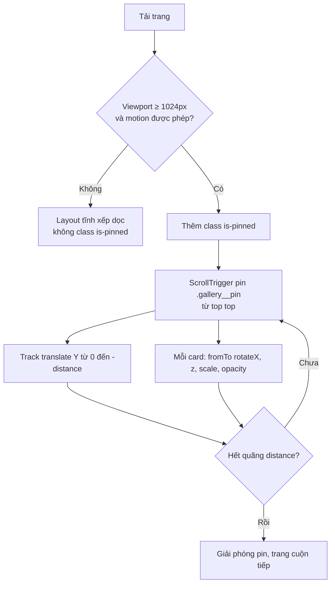

# Hướng dẫn kỹ thuật: Pinned Vertical Gallery (14 Projects)

## 1. Mục tiêu

- Section gallery **pin** (cố định) trong lúc user cuộn.
- 14 card ảnh tĩnh di chuyển **lên trên** theo tiến trình scroll (`scrub`).
- Mỗi card có hiệu ứng chiều sâu nhẹ: `rotateX`, `translateZ`, `scale`, `opacity`.
- Hết card cuối thì giải phóng pin, trang cuộn tiếp bình thường.
- Desktop (≥1024px) và motion được phép: có pin. Mobile, reduced motion, JS tắt: layout tĩnh xếp dọc.

## 2. Cấu trúc thư mục

```
project-gallery/
├── index.html              # Markup, 14 card, tải GSAP và script
├── css/
│   └── gallery.css         # Layout tĩnh, layer pinned, reduced motion
├── js/
│   └── gallery.js          # ScrollTrigger: pin, scrub, depth
├── assets/
│   └── project-01.webp … project-14.webp   # Ảnh 1200×1500 (4:5), cần tự chuẩn bị
└── HUONG-DAN-KY-THUAT.md   # File này
```

## 3. Luồng hoạt động



## 4. Cơ chế timeline

Timeline tổng có độ dài chuẩn hóa 1. Scroll được ánh xạ tuyến tính vào timeline nhờ `ease: "none"` và `scrub`.

| Thành phần | Vị trí trên timeline | Độ dài |
|---|---|---|
| Track đi lên | `0` | `1` |
| Card `i` | `(i / (n − 1)) × (1 − d)` | `d` (mặc định 0.35) |

Với `n = 14` và `d = 0.35`, card đầu bắt đầu tại `0`, card cuối bắt đầu tại `0.65` và kết thúc tại `1`. Các card không bị "trễ" ngoài timeline.

Quãng cuộn pin là `distance() = track.scrollHeight − window.innerHeight`. Hàm này được đánh giá lại khi `invalidateOnRefresh: true` kích hoạt, nên resize vẫn đúng.

## 5. Thông số có thể chỉnh

| Tham số | Vị trí | Mặc định | Tác dụng |
|---|---|---|---|
| `CARD_DURATION` | `gallery.js` | `0.35` | Card vào nhanh hay chậm. Giá trị lớn hơn làm các card chồng lấn nhiều hơn. |
| `FROM.rotateX` | `gallery.js` | `14` | Độ nghiêng lúc card vào. Đặt `0` để bỏ hiệu ứng nghiêng. |
| `FROM.z` | `gallery.js` | `-220` | Độ sâu lúc card vào. Âm là lùi xa, dương là nổi lên trước. |
| `FROM.scale` | `gallery.js` | `0.92` | Kích thước lúc card vào. |
| `FROM.opacity` | `gallery.js` | `0.35` | Độ mờ lúc card vào. |
| `scrub` | `gallery.js` | `1` | Độ trễ đuổi theo scroll (giây). Số lớn hơn cho cảm giác mượt, nhưng chậm phản hồi hơn. |
| `--gallery-gap-pinned` | `gallery.css` | `30svh` | Khoảng cách giữa các card. Ảnh hưởng nhịp cuộn. |
| `--gallery-card-w-pinned` | `gallery.css` | `min(42vw, 640px)` | Chiều rộng card. |
| `min-width` trong `matchMedia` | `gallery.js` | `1024px` | Ngưỡng bật pin. |

## 6. Thiết lập ảnh

- Tỉ lệ 4:5, kích thước gốc 1200×1500, xuất WebP (chất lượng 75–80). Có thể thêm AVIF nếu pipeline hỗ trợ.
- Tên file khớp với `index.html`: `project-01.webp` đến `project-14.webp`.
- Giữ `width` và `height` trong thẻ `` để trình duyệt giữ chỗ, tránh CLS (layout shift).
- Dung lượng mục tiêu: dưới 200 KB mỗi ảnh. Với 14 ảnh, tổng dưới 3 MB.

## 7. Tích hợp với Lenis (smooth scroll)

Nếu dự án dùng Lenis, đồng bộ hai bộ điều khiển để pin không lệch:

```js
const lenis = new Lenis();

lenis.on("scroll", ScrollTrigger.update);

gsap.ticker.add((time) => {
  lenis.raf(time * 1000);
});

gsap.ticker.lagSmoothing(0);
```

Thêm đoạn này vào `gallery.js` trước `mm.add`, và chỉ chạy khi Lenis đã được tải. Thiếu bước `lagSmoothing(0)` thì pin sẽ giật khi tab mất focus rồi quay lại.

## 8. Phương án nâng cấp: không gian 3D nhiều lớp

Phiên bản hiện tại là **một cột thẳng có tilt nhẹ**. Để gần với reference hơn:

1. **So le ngang:** `--x` đã có sẵn trong HTML (0% và 14%). Thêm `x` vào `FROM` trong `gallery.js` để card bay từ hai bên vào.
2. **Độ sâu khác nhau:** Gán `z` ngẫu nhiên theo chỉ số card (ví dụ `z: -120 - (i % 3) * 80`). Giới hạn ở 3 mức để tránh rối.
3. **Lớp wireframe nền:** Đặt một SVG cố định phía sau `.gallery__pin`, animate `rotate` hoặc `y` với `scrub` chậm hơn track (ví dụ `duration` lớn hơn). Chỉ animate `transform`.

Chỉ làm bước 3 khi đã đo được hiệu năng ổn định ở bước 1 và 2.

## 9. Hiệu năng

- Chỉ animate `transform` và `opacity`. Tránh `top`, `left`, `width`, `height`, `margin` trong timeline.
- `will-change` chỉ đặt trong layer pinned, và được gỡ khi reduced motion. Không đặt cho 14 card cùng lúc nếu không cần.
- Dùng `loading="lazy"` cho ảnh ngoài viewport. Với ảnh đầu tiên trong vùng nhìn thấy, có thể bỏ `loading` để tải ngay.
- Kiểm tra Performance trong Chrome DevTools, tab Rendering, bật "Paint flashing" và "Layer borders" khi scroll.
- Mục tiêu: 60 fps trên laptop trung bình. Trên mobile không pin nên không tính.

## 10. Accessibility (WCAG 2.1)

| Tiêu chí | Cách xử lý trong code |
|---|---|
| 1.3.2 Meaningful Sequence | DOM theo đúng thứ tự thị giác. Screen reader đọc đúng thứ tự project. |
| 1.1.1 Non-text Content | Mỗi ảnh có `alt` mô tả. Cần viết alt cụ thể, không dùng "project 01". |
| 2.1.1 Keyboard | Gallery không có control riêng nên không có bẫy bàn phím. Nếu thêm link trong card, cần kiểm tra focus có nằm đúng trong vùng nhìn thấy khi pin. |
| 2.2.2 Pause, Stop, Hide | Chuyển động chỉ chạy theo scroll của user, không tự chạy, nên không cần nút dừng. |
| 2.3.3 Animation from Interactions | `prefers-reduced-motion` tắt pin và transform trong CSS và JS. |
| 2.4.1 Bypass Blocks | Nếu trang có nhiều section, nên thêm link "Bỏ qua gallery" ở đầu trang. |

## 11. Mobile và touch

- Dưới 1024px, `matchMedia` không khớp. Không có class `is-pinned`, không có pin, không có transform 3D.
- Không dùng hover để kích hoạt hiệu ứng. Không có nhãn con trỏ theo chuột trong phiên bản này.
- Kiểm tra trên iOS Safari: `100svh` được hỗ trợ từ iOS 15.4. Với trình duyệt cũ hơn, thêm fallback `height: 100vh` trước dòng `svh`.

## 12. Checklist kiểm thử

- [ ] Desktop 1440px: pin đúng từ đầu section, track đi lên mượt, card cuối lên hết rồi pin được giải phóng.
- [ ] Resize từ desktop xuống dưới 1024px: class `is-pinned` được gỡ, layout chuyển về xếp dọc, không kẹt transform.
- [ ] Resize ngược lại: pin tái khởi tạo, không chồng hai timeline.
- [ ] Bật `prefers-reduced-motion` trong DevTools (Rendering → Emulate CSS media): không pin, không transform.
- [ ] Tắt JS: layout tĩnh vẫn đọc được đủ 14 project.
- [ ] Refresh giữa trang: vị trí pin đúng, không nhảy.
- [ ] Ảnh tải chậm (throttling Slow 3G): không layout shift nhờ `width` và `height`.
- [ ] Bàn phím Tab và screen reader (VoiceOver hoặc NVDA) đọc đúng thứ tự.
- [ ] Không có lỗi trong Console.

## 13. Giới hạn đã biết

- Phiên bản này chưa có lớp 3D nhiều độ sâu và wireframe nền như reference. Xem mục 8.
- Nếu chiều cao ảnh thực tế khác 4:5, card sẽ cao hơn hoặc thấp hơn và quãng pin thay đổi theo. Nên giữ đúng tỉ lệ.
- Nếu sau này thêm nội dung động trong card (video, carousel), cần gọi `ScrollTrigger.refresh()` sau khi nội dung đổi kích thước.

## 14. Dùng trong npm project

Nếu không dùng CDN, cài package và import trực tiếp:

```bash
npm install gsap
```

```js
import gsap from "gsap";
import { ScrollTrigger } from "gsap/ScrollTrigger";
```

Và bỏ hai thẻ `<script>` GSAP trong `index.html`, giữ `js/gallery.js` (đổi thành module nếu cần).

## 15. Ghi chú về Framer

Framer native không đủ để giữ pin kiểu này với timeline nhiều card. Cách làm là dựng Code Component dùng GSAP và ScrollTrigger như trên, rồi gắn vào canvas. Không dùng Scroll Effects của Framer cho phần pin.
